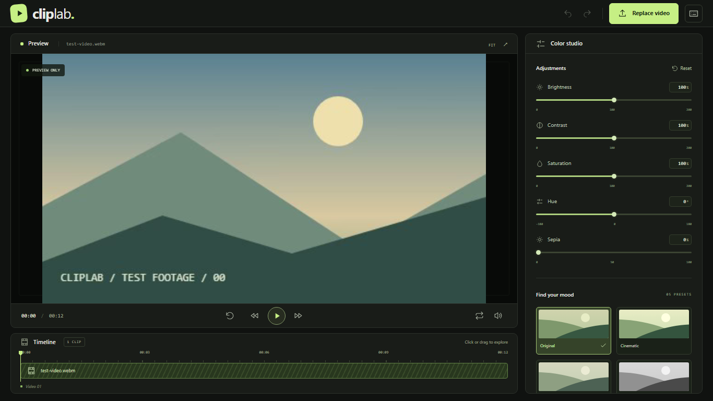

# ClipLab

A browser-based video editing playground. Open a local video, adjust its colors,
and preview different looks in real time.

[Live demo](https://cliplab-playground.netlify.app)



## Features

- Local video loading through a file picker or drag and drop.
- Playback, seeking, loop, mute, fullscreen, and an interactive timeline.
- Local MP4 and WebM export with current edits, optional audio, progress, and cancellation.
- Selectable export quality and adjustable dithering to reduce visible banding.
- Optional 10-bit SDR export with floating-point processing and compatible native encoders.
- WebGL2 preview with exposure, shadows, highlights, white balance, and visual effects.
- Color Mixer with independent hue, saturation, and luminance for eight color ranges.
- Local 3D `.cube` LUT gallery with selection, intensity, and bypass controls.
- Presets and a draggable before/after comparison.
- Undo/redo, individual slider resets, and category resets.
- Automatic local session recovery, including the video, adjustments, LUTs, and playback position.
- Customizable keyboard shortcuts and a responsive, collapsible workspace.

## Built with

- React and TypeScript
- Vite and Tailwind CSS
- WebGL2 and the HTML5 Video API
- WebCodecs and Mediabunny for video export
- IndexedDB for session storage and localStorage for shortcut preferences

## Run locally

Requires Node.js 24 and npm.

```sh
git clone https://github.com/arielBiagio/cliplab.git
cd cliplab
npm ci
npm run dev
```

## Scope and privacy

Videos and LUTs stay on your device. Session recovery uses local browser storage
and does not synchronize between devices. No backend or account is required.

Designed for desktop Chrome and Edge. Export supports SDR video up to 1080p without
upscaling; format and audio availability depend on browser codecs. The initial
download limit is 512 MiB. Trimming and multitrack editing are not available.
10-bit export supports BT.709 SDR footage and requires floating-point WebGL
rendering and a compatible HEVC, VP9, or AV1 encoder. Some decoder pixel formats
also require float16 canvas support. HDR output is not supported.
